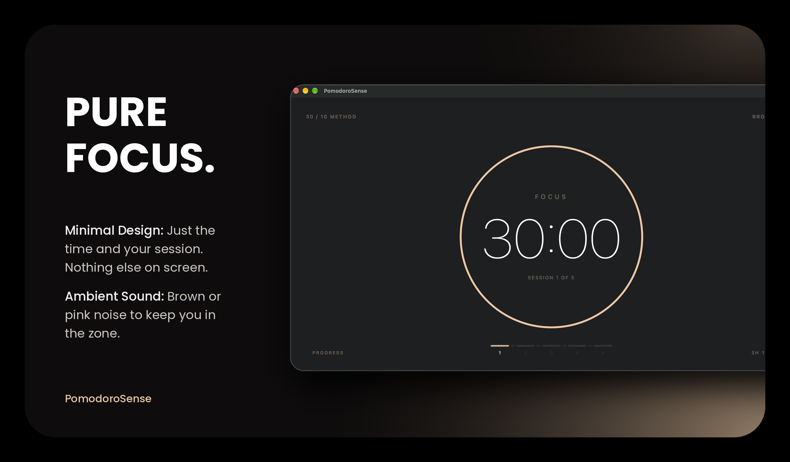
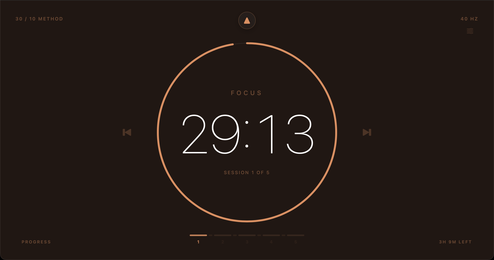
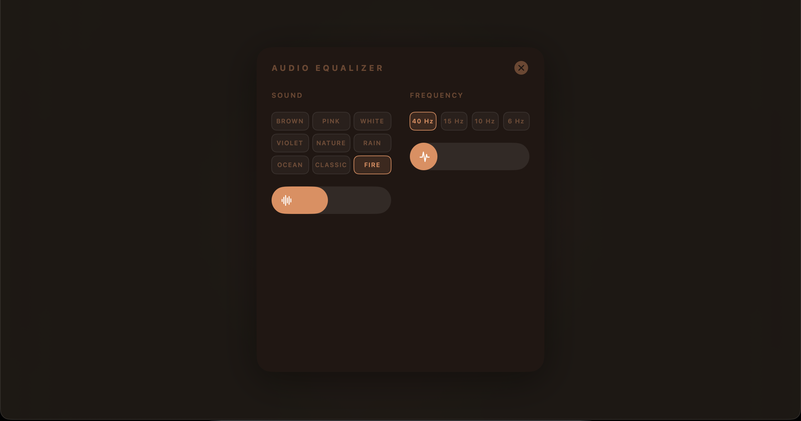
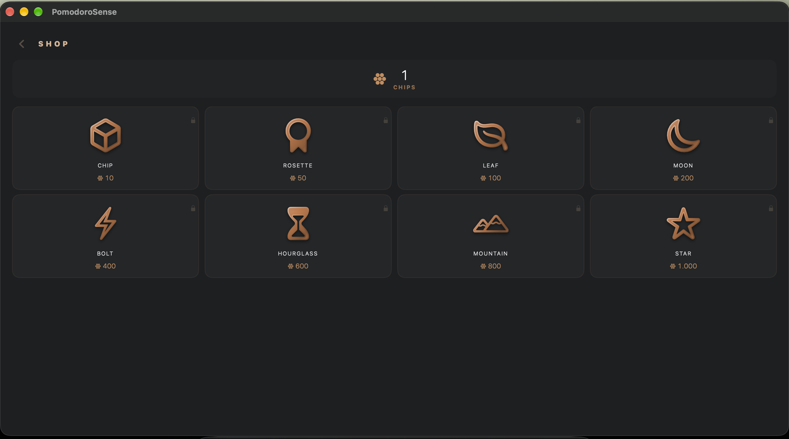
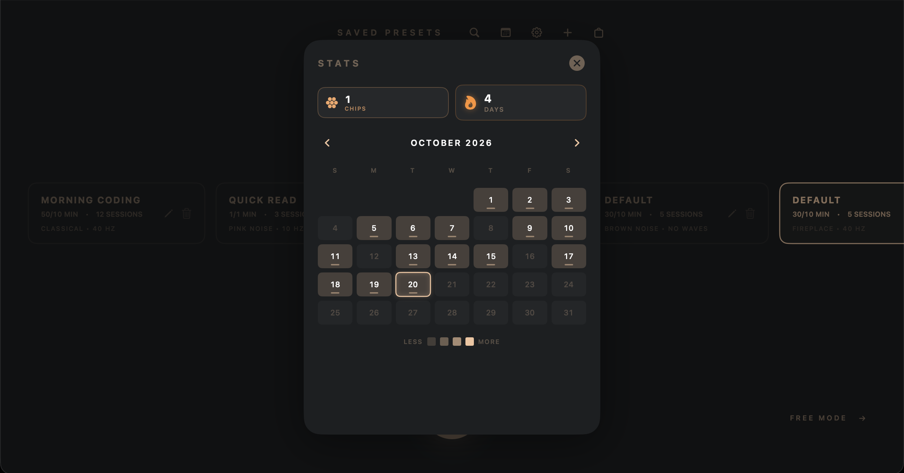

<h1 align="center">PomodoroSense PreRelease</h1>

<p align="center">
  <em>A focus timer for Apple devices. Private, native, with a small reward system that stays out of your way.</em>
</p>

<p align="center">
  <a href="#features">Features</a> ·
  <a href="#screenshots">Screenshots</a> ·
  <a href="#installation">Installation</a> ·
  <a href="#keyboard-shortcuts">Shortcuts</a> ·
  <a href="#tech-stack">Tech Stack</a> ·
  <a href="#architecture">Architecture</a> ·
  <a href="#privacy">Privacy</a> ·
  <a href="#license">License</a>
</p>

<p align="center">
  
  
  
  
  <a href="https://polyformproject.org/licenses/noncommercial/1.0.0/">
    
  </a>
  <a href="https://github.com/tomasagustinrossi">
    
  </a>
</p>

<p align="center">
  
  <br>
  <sub><i><!-- TODO: add hero image (main timer screenshot, 820×460) --></i></sub>
</p>

---

**PomodoroSense** is a Pomodoro timer for iOS and macOS. It has focus sessions, a simple progression system, an audio engine that generates everything in real time, and a Mirror Mode that keeps two devices in sync without going through any server.

I wanted it to feel like a real Apple app: spring animations, consistent haptics, a different color theme for each soundscape, and Live Activities and widgets on both the iPhone and the Mac desktop.

---

## Table of Contents

- [Why PomodoroSense](#why-pomodorosense)
- [Features](#features)
  - [Focus Timer](#focus-timer)
  - [Free Mode](#free-mode)
  - [Audio Engine](#audio-engine)
  - [Live Activities & Widgets](#live-activities--widgets)
  - [Mirror Mode](#mirror-mode)
  - [Economy & Streaks](#economy--streaks)
  - [Shop](#shop)
  - [Calendar & Stats](#calendar--stats)
  - [Design](#design)
- [Screenshots](#screenshots)
- [Installation](#installation)
- [Keyboard Shortcuts](#keyboard-shortcuts)
- [Tech Stack](#tech-stack)
- [Architecture](#architecture)
- [Privacy](#privacy)
- [How PomodoroSense was built](#how-pomodorosense-was-built)
- [Contributing](#contributing)
- [Author](#author)
- [License](#license)
- [Acknowledgments](#acknowledgments)

---

## Why PomodoroSense

Most Pomodoro apps I tried were either too basic or too social. This is the one I built for myself, which explains a few of the choices:

- **Native on iOS and macOS.** It's not a port or a web wrapper. Everything is SwiftUI, with platform-specific pieces where they make sense: a menu bar app on Mac and the Dynamic Island on iPhone.
- **No account, no cloud, no telemetry.** Mirror Mode syncs over your local network with end-to-end encryption. Your focus data stays on your devices.
- **A calm economy.** Finish sessions and you earn chips. Keep a streak and you unlock new things. The rewards are real, the loop is gentle, and the numbers are tuned so it never turns into a slot machine.
- **Audio you can live with.** Procedural noise, binaural beats and ambient soundscapes, each with its own volume curve.
- **Attention to detail.** HIG-aligned motion, haptics that match the context, and colors that change with each sound.

---

## Features

### Focus Timer

- **Custom presets.** Set the focus length, the break length and the number of sessions.
- **In-session controls.** Pause, resume, skip forward, skip backward and reset, from the app, the widget or the Live Activity.
- **Session selection.** Tap the session bar to jump to any session in the current preset.
- **State restoration.** If the system kills the app, the interrupted session is saved and picked up again on relaunch (this can be turned off).
- **Phase transitions.** The cycle goes focus, break, focus and so on until it's done. It also handles midnight: a preset that starts at 23:50 and ends at 00:20 counts fully for the day it ended.

### Free Mode

- **An unlimited timer** with no structure: start, pause, stop.
- Good for deep work that doesn't fit a Pomodoro pattern.
- **Session history** with duration, time range and optional notes.
- **Full audio support** (noise, binaural, ambient). It uses the same engine as Pomodoro, in a separate session.

### Audio Engine

- **Procedural noise** generated in real time on the audio thread: brown, pink, white and violet.
- **Binaural beats** with a 432 Hz carrier:
  - Gamma (40 Hz) for peak focus
  - Beta (15 Hz) for active concentration
  - Alpha (10 Hz) for relaxed alertness
  - Theta (6 Hz) for deep calm
- **Ambient soundscapes:** nature, rain, ocean, classical music and fireplace.
- **Per-source volume** with smooth exponential curves, plus fade-in and fade-out when you play, pause or stop.
- **Independent mixing.** Binaural, noise and ambience can all play at once.
- **Real-time equalizer** in the app, so you can adjust each source as you go.
- **Background audio.** It keeps playing while the app is in the background (this needs `UIBackgroundModes: audio`).

### Live Activities & Widgets

- **Dynamic Island** (iPhone) with a live countdown, the phase label, session progress, and controls for pause, resume, skip and stop.
- **Lock Screen Live Activity** with the same controls and a bigger clock.
- **Home Screen widget** (iOS) and **desktop widget** (macOS) showing the current timer, your chips balance and your streak.
- **Reward panel.** When a session completes, the Live Activity turns into a compact summary with the chips earned and the streak update.
- **Update deduplication.** An update is only sent when the state really changes, so ActivityKit doesn't drop frames.
- **Foreground retry.** If iOS blocked the first `Activity.request` while the app was in the background, the Live Activity is requested again when you come back to the app.

### Mirror Mode

- **Peer-to-peer sync** between two devices on the local network.
- **No cloud, no account, no server.** Pairing uses a shared key derived from a 16-character code (shown as a QR or as text you can copy), sent over TLS-PSK.
- **Master / Mirror roles** that get negotiated automatically in the connection handshake.
- **Automatic reconnection** with state reconciliation. If the connection drops, both sides carry on without losing the active session.
- **Control from either side.** Pause, resume, skip and stop show up on the other device in real time.
- **Live Activity on the Mirror.** The Mirror shows the Master's timer in its own Dynamic Island, updated live while the app is in the foreground.

> Mirror Mode is built for the most common case: your iPhone and your Mac, or two iPhones on the same Wi-Fi, with nothing to set up beyond scanning a QR.

### Economy & Streaks

- **Daily streaks** with an exponential multiplier. The longer you keep the habit, the more each session is worth.
- **Chips** for every completed focus session, with a soft cap that grows with your streak.
- **Session quality multipliers.** Longer focus sessions pay more per minute than short ones.
- **Lucky sessions.** Occasional bonuses on longer sessions that keep the economy interesting without feeling random.
- **Soft daily caps** on every currency, to prevent grinding, keep the balance meaningful and let the streak stay the main signal.
- **Prestige progression.** As your streak grows, new item tiers unlock in the shop. The details are a surprise, so you'll have to play to find them.
- **Tier unlock popups** that celebrate each new milestone.

### Shop

- **3D items** rendered with SceneKit, using metallic materials per tier (bronze, silver and higher).
- **Several visual sources:** SF Symbols, PNG/JPG images and full `.usdz` models.
- **Procedural extrusion.** Image-based items are extruded from their alpha silhouette, with a beveled edge and correct handling of holes.
- **Rotating previews** in the item detail popup, with drag to rotate.
- **Persistent collection.** Whatever you buy stays yours.
- **"My Collection" view:** a gallery of everything you own, with 3D previews.

### Calendar & Stats

- **Focus heatmap** of the last 90 days, colored by how intense each day was.
- **Adaptive color tiers.** The thresholds are recalculated from the last 30 days using percentiles, so the calendar adjusts to your own pace.
- **Daily goals.** Set a goal for any day, mark it with a star when you hit it, and see how much focus time you've logged toward it.
- **Day detail popup.** Tap any day to see its full session list (focus minutes, break minutes, total sessions) and manage that day's goal.
- **Monthly reports.** Records older than 90 days are compacted automatically into monthly summaries, so the app stays light and you keep your history.
- **Wallet summary** with chips, silver and streak totals at a glance.

### Design

- **Adaptive themes.** Each ambient soundscape has its own palette for focus and break phases.
- **Spring-based motion** throughout, with no linear easing.
- **Contextual haptics** on iOS: press, release, success, warning and error.
- **Native macOS experience:** a menu bar app with a live timer label, keyboard navigation and a Dock bounce on every phase change.
- **Multi-platform, one codebase.** Models and view models are shared, and the views are specific to each platform.

---

## Screenshots

<!-- TODO: Replace with real screenshots. Suggested 4–6 images, 2x retina, ~800–1200px wide. -->

<p align="center">
  
  
  
  
</p>

<p align="center">
  <sub>Timer · Equalizer · Shop · Calendar</sub>
</p>

<!-- TODO (optional):
- Screenshot of the Dynamic Island with a running session.
- Photo of two devices side by side in Mirror Mode.
- Screenshot of Free Mode with session history.
- macOS menu bar with the timer label.
-->

---

## Installation

### Requirements

- **iOS 17.0+** or **macOS 14.0+**
- Xcode 16.0+ (to build from source)
- Swift 5.9+

### App Store

<!-- TODO: Link to App Store / Mac App Store if published. Otherwise remove this section. -->

_Coming soon. App 1 of 10._

### Build from source

```bash
git clone https://github.com/tomasagustinrossi/PomodoroSense.git
cd PomodoroSense
open PomodoroSense.xcodeproj
```

Then in Xcode:

1. Select the **PomodoroSense** scheme.
2. Pick a destination (iOS Simulator, a physical iPhone, or "My Mac").
3. Press `⌘ + R` to build and run.

> **Note**: Mirror Mode uses the local network. On iOS, the first time you open Sync Settings you'll be asked for Local Network permission.

---

## Keyboard Shortcuts

### macOS

| Action | Shortcut |
|--------|----------|
| Play / Pause | `Space` or `Return` |
| Skip to previous session | `←` |
| Skip to next session | `→` |
| Back to presets | `↓` or `↑` |
| Close popup / dismiss | `Esc` |
| New preset | `⌘ + N` (when on presets screen) |
| Focus next control | `Tab` |
| Focus previous control | `Shift + Tab` |
| Activate focused control | `Return` |

### iOS

| Action | Gesture |
|--------|---------|
| Play / Pause | Tap the timer |
| Skip / Previous | Swipe on the session bar |
| Back to presets | Swipe up (portrait) or left (landscape) |
| Select a session | Long-press on the session bar, then drag |
| Open equalizer | Tap the sliders icon (top right) |

---

## Tech Stack

| Layer | Technology |
|-------|------------|
| UI | **SwiftUI** (iOS + macOS) |
| 3D | **SceneKit** with custom extrusion for shop items |
| Audio | **AVFoundation** (procedural noise, binaural, ambient files) |
| Live Activities | **ActivityKit** (iOS 16.2+, Dynamic Island + Lock Screen) |
| Widgets | **WidgetKit** (Home Screen + macOS desktop) |
| P2P Sync | **Network.framework** (Bonjour + TLS-PSK, `_pomodorosense._tcp`) |
| Crypto | **CryptoKit** (SHA-256 for pairing key derivation) |
| Persistence | **UserDefaults** + **Keychain** (peer ID, pairing key) |
| Testing | **Swift Testing** (`@Test`, `@Suite`, `#expect`) |

**No external dependencies.** No pods and no SPM packages. Everything comes with the SDK.

---

## Architecture

- **MVVM** with `@MainActor` ViewModels and plain SwiftUI views.
- **Balance files.** Every tuning number lives in a `*Balance.swift` file (audio, score, quality, sync). Change one file and the whole app rebalances.
- **A single source of truth.** `SessionStore` owns all persistent state (records, wallet, goals, reports), and everything else observes it.
- **Testable predicates.** Live Activity and widget logic is split into pure functions (`LiveActivityFilter`, `WidgetCommandDecision`) that are tested without the UI.
- **P2P first.** Mirror Mode never touches a server. Key derivation, framing, the connection lifecycle and reconnection all happen locally.
- **Graceful degradation.** Every feature has a fallback. If audio is missing, it stays silent. If Live Activities are disabled, the widget still works. If the connection drops, the local session keeps running.

---

## Privacy

- **No accounts and no sign-in.**
- **No analytics, telemetry or crash reporting.**
- **No server.** Nothing leaves your devices.
- **Mirror Mode is peer-to-peer.** Data goes straight between paired devices over your local network, encrypted with TLS-PSK.
- **Pairing keys** are stored in the system Keychain and never leave the device.
- **Session records** are stored locally in `UserDefaults` and, optionally, compacted monthly to keep the app light.

The only network permission the app asks for is:

- **Local Network**, which Mirror Mode needs for Bonjour discovery.

---

## How PomodoroSense was built

A team didn't build PomodoroSense. **One developer with a clear idea, a handful of AIs and a group of friends who gave honest feedback did.**

The idea came first. Every decision in this app, from the spring animations to the balance of the reward loop, from the color palettes per soundscape to how the Dynamic Island behaves under pressure, started as a single sentence in a conversation. The AIs helped turn those sentences into code. The friends helped make that code feel good to use.

### The vision

My main language is **C#**. Swift, SwiftUI, ActivityKit, Network.framework and the whole Apple ecosystem were new to me. The AIs weren't a shortcut. They were a tutor, a translator and a second pair of hands at the same time. Every pattern in this codebase (MVVM, `@MainActor`, property wrappers, phase management, the Live Activity lifecycle) I learned while building it.

But I never handed off the vision. What the app should feel like, what the reward loop should reward, what a session should taste like after 25 minutes of focus: I decided those things, talking it through with myself, and the people who actually use the app validated them later. The AIs wrote the syntax. The intent was mine.

### The AI stack

- **DeepSeek** was the main engine. Architecture, most of the Swift implementation, refactors and the day-to-day back and forth. If PomodoroSense has a "brain", it's here.
- **Gemini** was the planner and co-author of the base. Visual design, color systems, structural decisions and the early review passes. The first skeleton of the app came out of a Gemini conversation.
- **Claude** handled surgical fixes, bug hunting and code review. Every fix that landed in this repository was validated with tests before it was merged.
- **ChatGPT** made the images and visual assets: the rendered shop items, the icon compositions and some of the screenshots in this README.

The human in the loop, which is me, decided what to build, held the vision, tested on real devices, rejected broken code and kept the AIs honest. Nothing shipped without being run first.

### The friends

An app that *works* isn't the same as an app that *feels premium*. A small circle of friends closed that gap. They used early builds, complained about the right things, and celebrated the small wins as much as the big ones.

Because of them:

- The timer feels like a companion, not a countdown.
- The reward popup lands at exactly the right moment.
- The shop previews rotate at the right speed.
- The Dynamic Island doesn't flicker on a real device.
- The balance between challenging and rewarding feels like a balance, not a spreadsheet.
- The soundscapes are mixed at a volume you can stand for hours.
- The animations have a *feel*, not just a duration.

I wrote down every piece of feedback ("esto se siente lento", "no entiendo para qué es esto", "me encanta cuando pasa X"), we talked it over, and it ended up as a fix, a feature, or a deliberate decision to leave things alone. The friends didn't write code. But the app wouldn't exist in this form without them.

If you're one of those friends reading this: thank you. This app is as much yours as it is mine.

### A note on cost

I built this on free tiers. Every model listed above was used on its free plan, except Gemini, which was covered by a Google student pack. Total AI budget: zero. The real cost was time, and what I got back was a very steep learning curve packed into one project.

### A note on quality

Vibe coding isn't a shortcut. Every line in this repository was prompted, reviewed, iterated on and, above all, run. The 35+ unit tests, the tested predicates for Live Activities and widget commands, and the balance files that hold every tuning number didn't come from pressing a button. They came from thousands of small decisions made in conversation with several AIs, and from a developer who refused to ship anything he didn't understand.

PomodoroSense shows that one developer with the right tools, a clear idea and honest friends can build something that feels native, is tested and is carefully tuned, with no team, no budget and no pretending to already know the language he was writing in.

If you're a C# developer wondering whether you can build for Apple platforms without a Swift background, this repository is the answer. You can, as long as you're willing to read the docs, write the tests, learn the idioms one error at a time and listen to the people who use what you build.

---

## Contributing

Pull requests are welcome. For major changes, please open an issue first so we can talk about what you'd like to change.

### Development guidelines

- Keep the `*Balance.swift` files as the single source of truth for tuning numbers.
- All ViewModels stay `@MainActor`.
- New logic in Live Activity or Mirror Mode must be covered by tests in `PomodoroSenseTests/`.
- No external dependencies.
- Follow the HIG for motion and haptics.

### Reporting bugs

When you open an issue, please include:

- Platform (iOS / macOS) and version.
- Steps to reproduce.
- What you expected and what happened instead.
- Screenshots or a screen recording if the problem is visual.

---

## Author

**Tomas Rossi**

- GitHub: [@tomasagustinrossi](https://github.com/tomasagustinrossi)
- 🇦🇷 Built in Argentina.

PomodoroSense is a personal project. It's not a company, a startup or a product. It's a tool I built because I wanted it to exist, and I'm sharing it in case it's useful to someone else.

---

## License

PomodoroSense is licensed under the **PolyForm Noncommercial License 1.0.0**.

[](https://polyformproject.org/licenses/noncommercial/1.0.0/)

### Why this license

PolyForm Noncommercial is a modern source-available license written specifically for software. Unlike Creative Commons licenses, it's explicit about code, patents and linking, and it can be enforced in court. I picked it because it says two things in the cleanest way:

1. **You can read, run, learn from and adapt this code.**
2. **You can't sell it, and you can't publish it on the App Store.**

### What you can do

- ✅ **Read and learn from the code**: every file, every comment, every test.
- ✅ **Clone and run it locally** on your own devices.
- ✅ **Fork it for personal use**: modify it, break it, fix it, rebuild it.
- ✅ **Share it with friends** who want to run it on their own devices.
- ✅ **Contribute back** through pull requests.
- ✅ **Use it in education, research, charity or government.** PolyForm explicitly treats those as noncommercial uses.

### What you cannot do

- ❌ **Sell PomodoroSense or a derivative of it**, in any form.
- ❌ **Publish it on the App Store, Mac App Store, Google Play, Microsoft Store, Steam or any other commercial app distribution platform.** This applies even if you publish it for free, because the restriction is about the platform and not the price.
- ❌ **Use the code in any commercial product or service.**
- ❌ **Remove the copyright notice or the license file.**
- ❌ **Sublicense or transfer your rights to someone else.**

If you want to publish a product based on this work, you need **prior written permission from the author** and you must publish it under a substantially different product identity.

### Required notice

Under the PolyForm license, any distribution of PomodoroSense or of a derivative work must include a copy of the license and the following notice:

> **PomodoroSense** — Copyright (c) 2026 Tomas Rossi.
> Licensed under the PolyForm Noncommercial License 1.0.0.
> Source: https://github.com/tomasagustinrossi/PomodoroSense

### Full license text

The full text of the PolyForm Noncommercial License 1.0.0, including the extra App Store restriction the author added, is in [LICENSE](LICENSE). The canonical version is at [polyformproject.org/licenses/noncommercial/1.0.0](https://polyformproject.org/licenses/noncommercial/1.0.0/).

---

## Acknowledgments

- Inspired by the original Pomodoro Technique by Francesco Cirillo.
- The audio design borrows ideas from Paul Kellet's pink noise filter and the wider ambient audio community.
- **Built with AI, for humans.** PomodoroSense is a vibe-coded project. DeepSeek, Gemini, Claude and ChatGPT weren't just tools I used. They were the team I built it with. The full story is in [How PomodoroSense was built](#how-pomodorosense-was-built).
- Built with love in Argentina.

<p align="center">
  <sub>Made with ❤️, a lot of focus sessions and a handful of AIs.</sub>
</p>
